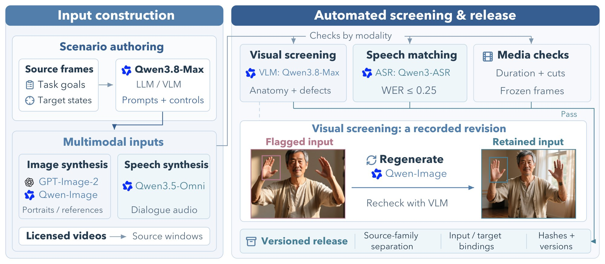
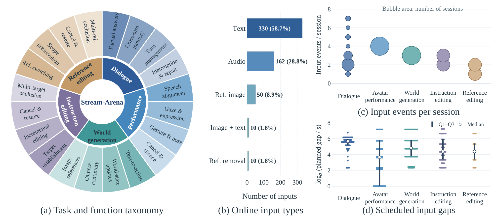

<div align="center">

# Stream-Arena

**交互式流式视频生成系统评测基准**

[](leaderboard/v1_leaderboard.md)
[](https://huggingface.co/datasets/StreamArena/Stream-Arena-Open)
[](https://www.modelscope.ai/datasets/StreamArena/Stream-Arena-Open)
[](LICENSE)
[](#许可)

[English](README.md) | **简体中文**

</div>

交互式流式视频生成要求系统在整场会话中响应不断变化的用户输入，同时保持已有内容和状态。**Stream-Arena**
包含五个任务，覆盖虚拟人交互、世界生成和实时视频编辑。会话时长 15–300 秒，多模态输入逐步到达（用户说话、
发布一条指令或一张参考图、源视频持续播放），既考察对新请求的执行，也考察对先前上下文的保持。系统输出按观众
接收到的样子录制，再由自动裁判对每场会话和每次响应打分。

## 概要

| | |
|---|---|
| 任务 | 数字人对话、虚拟人表演、世界生成、指令编辑、参考编辑 |
| 基准 | 300 个条件及 60 个文本对话衍生条件；报告的核心名册含 149 个有效条件 |
| 会话 | 15、30、60、120、300 秒五个时长层；每个条件重复 3 次 |
| 结果 | 39 个模型、49 个核心配置、4,389 次运行 |
| 流程 | 统一的会话 harness、统一的模型接口（进程内或 WebSocket）、统一的自动裁判 |
| 开放内容 | 代码、完整基准（时间轴、oracle、媒体）以及已发布结果 |

## 任务与指标

| 任务 | 系统接收的输入 | 评分指标 |
|---|---|---|
| 数字人对话 | 人像与人设；用户的语音（或文本）轮次 | Quality、A–V Sync、Stability、Dialogue、Identity |
| 虚拟人表演 | 人像；需要演绎的语音与实时动作指令 | Quality、A–V Sync、Stability、Following、Identity |
| 世界生成 | 开场提示（或图像）；实时提示与相机控制 | Quality、Stability、Following、Continuity（图像条件扩展集另加 Reference） |
| 指令编辑 | 实时源视频；文本编辑指令 | Quality、Stability、Following、Edit Success、Preservation |
| 参考编辑 | 实时源视频；需要应用、修补、移除或重置的参考图 | Quality、Stability、Reference、Edit Success、Preservation |

各指标为 0–100 分。任务的 Overall 是其适用内容指标的等权平均；仅公开论文中的内容分数，
不同任务之间不合并总分。[指标定义](docs/evaluation.md)。

## 基准



<sub>**基准构建与校验。** 先由模型辅助撰写和合成输入，再按模态分别检查。一张手部有缺陷的 Qwen-Image 人像被重新生成，并通过同样的筛查。</sub>



<sub>**基准构成。** (a) 任务与功能构成；(b) 计划输入类型；(c) 每场会话的输入数；(d) 相邻计划输入的间隔。
200 个核心与扩展条件共含 562 个在线事件，不含初始化和连续源视频帧；间隔统计不含包含触发事件的相邻对。</sub>

基准（[`benchmark/v1`](benchmark/v1/README.md)）共 300 个条件，每个任务 60 个、每个时长层 12 个，来自 240 个源
家族，另有 60 个文本对话衍生条件。结果在其中的固定名册上报告：

| 名册 | 目录 | 条件数 | 报告方式 |
|---|---|---:|---|
| 核心 | [`core`](benchmark/v1/core) | 149 | 主结果 |
| 扩展 | [`extension`](benchmark/v1/extension) | 50 | 附加条件 |
| 文本对话 | [`text`](benchmark/v1/text)、[`text_extension`](benchmark/v1/text_extension) | 30 + 10 | 文本输入对话 |
| 开发 | [`development`](benchmark/v1/development) | 100 + 20 | 命令行默认名册，用于接入调试 |

每个名册目录包含 `cases.jsonl`（输入时间轴）、`oracles.jsonl`（期望结果，仅裁判读取）和 `manifest.json`
（每个媒体文件及其 sha256）。媒体文件在数据集平台上（见[数据](#数据)）。

## 评测

- **Harness**：所有任务共用同一个 harness 和模型接口，按时钟释放输入并给输出打时间戳，每个响应都能对应到触发它的输入。
- **裁判**：结构化的视觉与文本观察经固定规则转换为分数；已记录的请求可离线回放。
- **打分**：对重复、条件和时长层等权聚合；无法判定的测量保留未确定状态，仅在计算展示下界时贡献零分。

## 结果

[结果表](leaderboard/v1_leaderboard.md)对应论文的五张核心表；
[JSON 文件](leaderboard/v1_leaderboard.json)仅包含其中 49 个配置及其指标状态。其他集合的结果、响应时间、覆盖率和详细数值诊断保留在评测者本地。各表按字母排序；A–V Sync 为暂定指标。

## 数据

本代码仓库发布 benchmark 实现、基准定义、评分规则和汇总结果。会话日志、逐次裁判记录、模型采样输出和输出展示由评测者本地保存。
Hugging Face 和 ModelScope 仅保存 benchmark 数据；实现代码和汇总结果表由本仓库提供。

基准定义在本仓库中；媒体文件（约 3.1 GB）在 [Hugging Face](https://huggingface.co/datasets/StreamArena/Stream-Arena-Open)
和 [ModelScope](https://www.modelscope.ai/datasets/StreamArena/Stream-Arena-Open) 上，两处文件相同：

```python
from huggingface_hub import snapshot_download        # 或：from modelscope import dataset_snapshot_download
path = snapshot_download("StreamArena/Stream-Arena-Open", repo_type="dataset")
```

```bash
export STREAM_ARENA_DATA=<path>/data                  # 包含 v1/
stream-arena validate --benchmark benchmark/v1/core   # 按 manifest 校验每个文件及其 sha256
```

## 快速开始

需要 Linux 或 macOS 上的 Python ≥ 3.10。第一步检查使用生成的纯 CPU 媒体，不需要 API key、GPU 或下载数据。

```bash
git clone https://github.com/StreamArena/Stream-Arena-Open.git stream-arena && cd stream-arena
python -m venv .venv && source .venv/bin/activate
python -m pip install -e ".[runtime,judge,dev]"
python -m stream_arena.benchmark.synthetic --out .smoke
stream-arena run --model stream_arena.models.mock:MockModel --track instruction_edit \
  --case sa.v1.901.instruction_edit --benchmark .smoke/set --data .smoke/data --out .smoke/attempt
stream-arena validate-run .smoke/attempt --benchmark .smoke/set --data .smoke/data
pytest -q
```

评测已注册的系统：下载媒体、安装模型依赖并配置裁判凭据：

```bash
cp .env.example .env
stream-arena list
stream-arena evaluate --system ID --out runs                                         # 开发名册
stream-arena evaluate --system ID --out runs_core --benchmark benchmark/v1/core --population core
```

与论文可比的结果使用核心名册。分阶段运行与裁判回放见 [docs/reproduce.md](docs/reproduce.md)；v1 系统列表见
[models/README.md](models/README.md)。

## 接入你的模型

实现一个类，并在 `system.json` 中注册：

```python
from stream_arena.models import OutputSink, SessionInit, StreamingModel

class MyModel(StreamingModel):
    def open(self, init: SessionInit, sink: OutputSink): ...   # 人像 / 提示 / 输出尺寸；调用 sink.ready(...)
    def push_audio(self, pts_ns, pcm16k): ...                  # 虚拟人任务：10 ms 语音分片
    def push_source_frame(self, pts_ns, jpeg): ...             # 编辑任务：实时源视频
    def send_event(self, event): ...                           # 已释放的文本 / 参考事件；调用 sink.ack(...)
    def close(self) -> bool: ...
# 输出：sink.video_frame(jpeg)、sink.audio(pcm48k)
```

也可以用任意语言实现 WebSocket 服务端接入。从 [`examples/my_model`](examples/my_model) 和
[docs/add_a_model.md](docs/add_a_model.md) 开始。

## 文档

| 文档 | 内容 |
|---|---|
| [docs/add_a_model.md](docs/add_a_model.md) | 模型接口、`system.json`、服务端、组合式虚拟人、厂商适配器 |
| [docs/protocol.md](docs/protocol.md) | WebSocket 协议与每场会话的产物 |
| [docs/evaluation.md](docs/evaluation.md) | 指标、聚合与裁判 |
| [docs/reproduce.md](docs/reproduce.md) | 运行一个集合、分阶段运行、裁判回放、结果文件 |
| [benchmark/v1/README.md](benchmark/v1/README.md) | 基准、各名册与勘误 |
| [leaderboard/README.md](leaderboard/README.md) | 已发布结果及其格式 |
| [models/README.md](models/README.md) | v1 系统：上游代码、权重与许可 |

## 引用

```bibtex
@misc{streamarena2026,
  title        = {Stream-Arena: Evaluating Interactive Streaming Video Generation Systems},
  author       = {{Stream-Arena Team}},
  year         = {2026},
  howpublished = {\url{https://github.com/StreamArena/Stream-Arena-Open}}
}
```

## 许可

- **代码**：[Apache License 2.0](LICENSE)。被封装的第三方模型保留其原许可，其中部分为非商用
  （[models/README.md](models/README.md)）；厂商适配器受各厂商服务条款约束。
- **基准数据**（时间轴、oracle、生成媒体、结果）：[CC BY 4.0](https://creativecommons.org/licenses/by/4.0/)。
  编辑任务的源视频节选自第三方素材，保留其原许可（CC BY、CC BY-SA、CC0 或公有领域）；使用时（包括发布编辑后的输出）
  请按 [benchmark/v1/ATTRIBUTION.md](benchmark/v1/ATTRIBUTION.md) 署名。详见 [NOTICE](NOTICE)。
